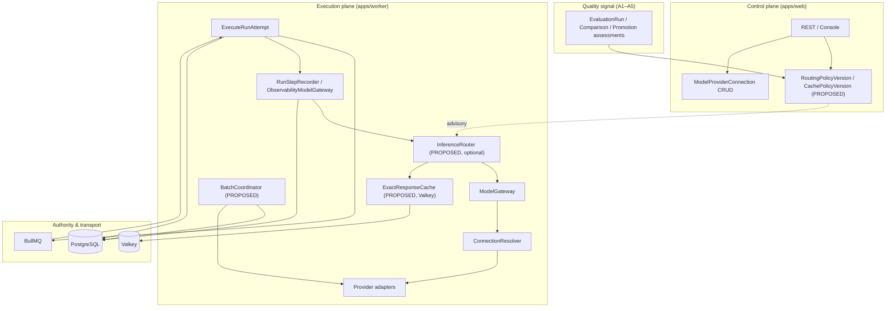
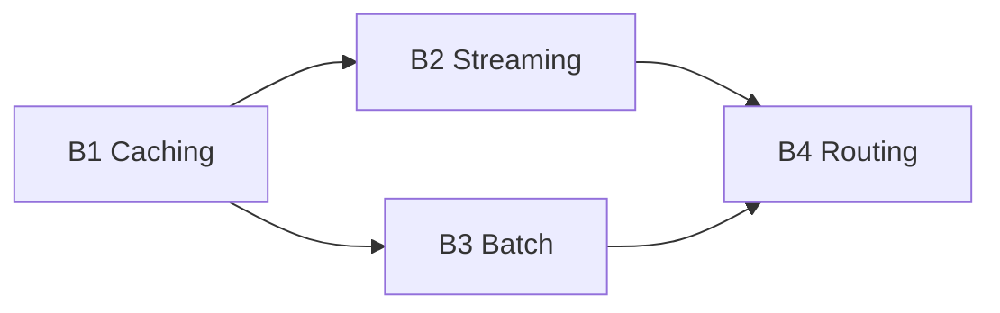

# AI Inference Optimization — Target Architecture (B0)

Status: **PROPOSED** (design milestone B0; no production implementation in this slice).

## Purpose

Extend OSVA model execution with optional **caching**, **streaming**, **batch inference**, and **policy-driven routing** while preserving existing invariants:

- PostgreSQL is lifecycle and accounting authority.
- BullMQ + Valkey are transport only.
- Model calls flow **runtime → ModelGateway → provider adapter** (never direct SDK in domain).
- `ModelProfileVersion` and `Run.effectiveBindings` remain immutable execution inputs.
- A provider **prompt-cache hit** is still a provider invocation; an **exact-response cache hit** is not.

This document is the target end-state. See `docs/implementation/B0_INFERENCE_OPTIMIZATION_AUDIT.md` for evidence and `docs/adr/ADR-012-inference-optimization-architecture.md` for decisions.

## Scope boundaries

| In scope (B1–B4) | Out of scope (B0+) |
| --- | --- |
| Workspace-scoped exact-response cache | Semantic caching as default |
| Provider-native cache accounting (existing) + optional cache breakpoints | LiteLLM as required dependency |
| Token/event streaming to clients | Arbitrary mid-stream resume without provider support |
| Provider-native batch jobs + OSVA reconciliation | Replacing BullMQ for Run execution |
| Evaluation-informed **recommendations**, not auto-policy | Evaluation-driven automatic production routing |

## Responsibility map

### Ownership table

| Responsibility | Owner | Notes |
| --- | --- | --- |
| Run / RunAttempt lifecycle | PostgreSQL + `ExecuteRunAttempt` | Unchanged |
| Model authorization | Effective bindings + workspace connection binding | No adapter-side bypass |
| Credential resolution | `ModelProviderConnectionResolver` | Secrets via `SecretResolver` |
| Provider HTTP call | `ModelProviderAdapter` | One observable attempt per RunStep (SDK retries disabled for connections) |
| Token usage & cost estimate | Adapters → `RunStep` + `estimateModelCostUsdMicros` | Null = unknown, never fabricated zero |
| Exact-response cache | **PROPOSED** `ExactResponseCache` port | Valkey; workspace-namespaced |
| Routing decision | **PROPOSED** `InferenceRouter` | Deterministic under frozen policy snapshot |
| Provider batch lifecycle | **PROPOSED** `BatchInferenceJob` persistence | Immutable submission snapshot |
| Quality benchmarks | Evaluation A1–A5 | Recommendations only; human/policy gate for routing |
| HTTP abuse rate limits | `ValkeyFixedWindowRateLimiter` (web) | Not model budget enforcement |

## ModelGateway (current + extensions)

**Today:** `packages/model-gateway` loads `ModelProfileVersion`, resolves adapter via static map or `ModelProviderConnectionResolver`, invokes `generateText` / `generateCompletionOutcome`, normalizes errors and usage.

**Target extensions (incremental, behind policy):**

1. **Pre-invoke:** optional cache lookup (`ExactResponseCache`), optional routing (`InferenceRouter` selects `ModelProfileVersionId` from allowed set).
2. **Invoke:** existing adapter contract; optional streaming callback for B2.
3. **Post-invoke:** cache store on eligibility; finalize RunStep with `providerInvocation` vs `cacheHit` provenance.

Public contracts (`@osva-ai/contracts`) gain new types only when behavior is implemented; B0 does not add runtime fields.

## B1 — Caching architecture

### Layers (distinct)

1. **Provider-native prompt caching** — provider still invoked; usage includes `cachedInputTokens` / `cacheWriteInputTokens`. OSVA already persists these on `RunStep` and prices cache tiers when `ModelProfileVersion.pricing` defines rates.
2. **Exact-response caching** — optional; skip provider when key hits; RunStep records **cache hit** (no `providerRequestId`, no provider invocation metric).
3. **Single-flight deduplication** — optional; coalesce in-flight identical keys; separate from durable cache TTL.
4. **Semantic caching** — **disabled by default**; requires privacy/quality evidence before any PROPOSED pilot.

### Cache key (exact-response, PROPOSED)

Canonical BLAKE3/SHA-256 over ordered, normalized components:

- `workspaceId`
- `modelProfileVersionId`
- `modelProviderConnectionVersionId` (or explicit legacy sentinel)
- Provider model id from profile
- Generation parameters (`maxOutputTokens`, tools hash, `jsonSchema` hash)
- Normalized messages (roles + content; exclude secrets)
- **Execution policy version** id when policies affect eligibility (temperature, cache mode, stochastic allowance)
- Tool definitions stable hash

Never embed API keys, secret references, or raw PII in keys. Sensitive workloads: policy disables cache or encrypts values at rest (PROPOSED envelope key per workspace).

### B1.1 foundation (implemented)

Slice B1.1 adds **contracts and domain-only** building blocks (no ModelGateway hook, no Valkey adapter, no migrations):

- `@osva-ai/contracts` — `InferenceResponseCachePolicyV1`, `ExactResponseCachePort`, invocation provenance kinds (`PROVIDER_INVOKED`, `PROVIDER_PROMPT_CACHE_HIT`, `OSVA_RESPONSE_CACHE_HIT`), eligibility reason codes.
- `@osva/domain` — `buildInferenceCacheIdentity` (domain-separated SHA-256 v1 digest + workspace storage key), `evaluateInferenceCacheLookupEligibility` / `evaluateInferenceCacheStoreEligibility` (default disabled, fail-closed).

Identity format version: `INFERENCE_CACHE_IDENTITY_FORMAT_VERSION = "1"`. Storage keys use prefix `osva:erc:v1:` without prompt plaintext.

### B1.2 Valkey adapter (implemented)

Package `@osva/adapters-inference-cache-valkey` implements `ExactResponseCachePort` with an **independent** ioredis connection (not shared with BullMQ queue lifecycle).

- Authorized `workspaceId` on each lookup/put; storage key must match identity digest and workspace.
- Versioned JSON envelope v1 (`INFERENCE_CACHE_ENTRY_FORMAT_VERSION`); bounded size; TTL `[MIN, MAX]` seconds.
- Atomic conditional write: `SET key value EX ttl NX`.
- Infrastructure errors → `bypass`; authorization/key mismatch → `bypass` / `UNAUTHORIZED` (never silent miss).
- Corrupt wire → `corrupt`; expired envelope → `miss` with best-effort `DEL`.
- **Encryption:** B1.2 stored plaintext JSON in Valkey for adapter tests only. Production operator enablement (B1.4) wraps envelope bytes with AES-256-GCM (`wireFormatVersion` 1) before Valkey `SET`.
- **Single-flight:** deferred past B1.3 (documented limitation; concurrent misses may invoke provider more than once).

### B1.3 gateway integration (implemented)

`CachingModelGateway` in `@osva/model-gateway` decorates the existing `ModelGateway` when an `ExactResponseCachePort` is injected **and** `ModelGatewayGenerateTextOptions.cache` carries an enabled `REQUIRED_DETERMINISTIC` policy. Default product path is unchanged (no cache port, policy default-off).

- **Worker wiring (tests):** `createWorkerProcess({ exactResponseCache, trustedInferenceResponseCachePolicy })` for hermetic acceptance.
- **Observability:** `createRunStepRecorder` resolves cache context from trusted `execution.policyContext.inferenceResponseCache` and passes it to `generateTextOutcome`. OSVA response-cache hits finalize MODEL `RunStep` with `modelInvocationSource = OSVA_RESPONSE_CACHE_HIT`, skip `MODEL_CALLS` / provider token metrics, and exclude the step from RunAttempt provider usage aggregates.
- **PostgreSQL:** migration `0039_run_step_model_invocation_source` adds `model_invocation_source` and `estimated_avoided_cost_usd_micros` on `run_steps`.

### B1.4 production safety (implemented, review)

- **Encryption at rest:** `ValkeyExactResponseCache` optional `wireProtection` (AES-256-GCM, per-entry nonce, AAD = workspace + identity digest + storage key). Legacy plaintext entries rejected when protection is required.
- **Workspace policy:** migration `0040_workspace_inference_cache_policy`; `ExecuteRunAttempt` resolves `inferenceResponseCache` per workspace from PostgreSQL (default-off when no row). Runtime `ExecutionRequest` cannot enable caching.
- **Worker production wiring:** `OSVA_EXACT_RESPONSE_CACHE_ENABLED=true` plus encryption key env composes encrypted cache; no mandatory config when disabled.
- **Metrics:** `osva.inference_response_cache.events` counter (`kind`, optional `reason`) — no prompts or cache keys.
- **Provider prompt cache:** adapters already normalize provider-reported cached input tokens (OpenAI `cached_tokens`, Anthropic cache read tokens, Gemini cached content metadata). No additional explicit cache-control mutations in this slice (deferred where SDK evidence is insufficient).
- **Limitations:** no single-flight; no Console policy UI (use audited repository upsert); purge/rollback is operator-driven (see operations doc).

### Eligibility

Cache **only** when policy marks operation `CACHE_ELIGIBLE` and:

- Terminal success with complete output
- Authorized workspace context
- No side-effectful tool execution in the same logical operation (tool-loop completions generally ineligible until turn boundaries are defined)
- Failed / partial / cancelled calls never written

**Stochastic outputs:** default **do not cache** unless policy explicitly allows (`determinism: best_effort`) and temperature=0 (or provider equivalent) is verified in key material.

## B2 — Streaming architecture

### B2.1–B2.2 streaming (in-process, implemented)

- `@osva-ai/contracts`: versioned `ModelStreamEvent` vocabulary, zod schemas, `assembleModelStreamCompletion` terminal assembler.
- In-process delivery: `AsyncIterable<ModelStreamEvent>`. IPC/API: discrete framed events only.
- See `docs/implementation/B2_1_MODEL_STREAMING_FOUNDATION.md`.

### Planes (B2.2+)

| Plane | Mechanism | Durability |
| --- | --- | --- |
| Provider token stream | `generateCompletionStream` on adapters + ModelGateway (B2.2) | Trusted child IPC (B2.3); public HTTP (B2.4+) |
| Worker event delivery | Valkey Pub/Sub → Web SSE (B2.4A); Console BFF proxy → `useRunLiveStream` (B2.4B) | Ephemeral (no replay) |
| Product observability | `RunStep` terminal record | PostgreSQL |
| Runtime protocol | Framed model events (PROPOSED) | Terminal only unless event log added |

**Recommended:** **Hybrid C** — stream deltas ephemerally for UX; always complete provider call (or cache hit) and persist terminal `RunStep` + usage even if client disconnects, per execution policy (`terminateOnClientDisconnect: false` default for agent runs).

- Cancellation: `AbortSignal` linked to RunAttempt cancel; client disconnect detaches viewer by default.
- No claim of arbitrary resume without provider `stream_id` support.
- **B1:** streaming bypasses OSVA exact-response cache until designed; non-streaming cache unchanged.

Distinguish **container log streaming** (RuntimeExecuteResponse) from **LLM token streaming**.

## B3 — Batch inference architecture

Three mechanisms coexist:

| Mechanism | Use when |
| --- | --- |
| **BullMQ Run queue** | Agent/tool execution, evaluation child runs, judge/pairwise recovery |
| **Provider-native batch** | Large offline inference, provider discounts, tolerated latency (**explicit opt-in only**) |
| **In-process concurrent scheduling** | Bounded parallelism inside worker (PROPOSED caps) |

**B3.1 (done — contracts only):** Portable types in `@osva-ai/contracts` (`batch-inference`, transition + correlation helpers). See [B3_1_BATCH_INFERENCE_FOUNDATION.md](../implementation/B3_1_BATCH_INFERENCE_FOUNDATION.md).

**B3.2:** Multi-provider native batch (OpenAI, Anthropic, Gemini), migration `0042`, REST + worker lifecycle.

**B3.3:** Correlation quarantine, submit fencing, OTEL batch metrics, failure/restart/concurrency acceptance. See [B3_BATCH_INFERENCE_OPERATIONAL_ACCEPTANCE.md](../operations/B3_BATCH_INFERENCE_OPERATIONAL_ACCEPTANCE.md). Integration harness: 15 scenarios in `batch-inference-openai.integration.test.ts`.

**OSVA local job lifecycle** (authority in PostgreSQL): `CREATED` → `SUBMITTING` → `SUBMITTED` → `PROCESSING` → `FINALIZING` → `COMPLETED` | `PARTIALLY_COMPLETED` | `FAILED` | `CANCELLING` → `CANCELLED` | `EXPIRED`. Terminal states do not regress.

**Provider batch lifecycle** (normalized mirror, adapter-mapped): `VALIDATING` / `IN_PROGRESS` / `COMPLETED` / `FAILED` / `CANCELLING` / `CANCELLED` / `EXPIRED`. Provider `COMPLETED` does not imply all items succeeded.

Persist (B3.3+):

- Immutable submission snapshot (model, connection version, input artifact refs, `submissionFingerprint`)
- Provider batch id
- Per-item result refs + usage reconciliation
- Link to workspace; no cross-workspace batches
- Batch eligibility policy default **disabled**

Recovery: worker/orchestration tick polls provider status; crash-safe reconciliation (`submissionFingerprint` dedup); partial failures recorded per item. B1 exact-response cache and B2 streaming do not apply to provider batch retrieval.

## B4 — Intelligent model routing

**B4.1 (branch):** Implemented `RoutingModelGateway`, workspace policy versions, migration `0043`, and control-plane APIs. Default-off activation preserved. See [B4_INTELLIGENT_MODEL_ROUTING.md](../implementation/B4_INTELLIGENT_MODEL_ROUTING.md).

Routing sits **above** adapter selection, **below** workspace authorization:

**Inputs (frozen policy snapshot):**

- Allowed `ModelProfileVersionId` set
- Task capability requirements (tools, structured output, context length)
- Budget / max cost per call (PROPOSED)
- Latency target, quality threshold (from eval benchmarks)
- Provider availability / health (PROPOSED rolling window from RunStep errors)

**Strategies (explicit, deterministic):**

1. Static binding (today’s behavior)
2. Ordered fallback list
3. Cheapest eligible (priced profiles only)
4. Lowest latency eligible (p95 from observability)
5. Weighted cost/quality score
6. Evaluation-informed suggestion (A5 comparisons) — **recommendation export only**

Cold-start / missing benchmarks: fall back to static binding + audit log entry.

**Never** substitute models without workspace-approved policy version.

## Security and accounting

- Workspace isolation on cache keys, batch jobs, and connection resolution (existing foreign-workspace tests).
- Cache hit: `modelCalls` counter unchanged at provider; record `cacheHits` (PROPOSED metric).
- Provider prompt cache: still `modelCalls`; priced cache read/write tiers.
- Unknown usage → `usageIncomplete` / null cost (existing).
- Retries: logical retry = new `RunAttemptId`; SDK hidden retries disabled for connection-bound adapters.
- Audit events for policy changes and routing decisions (PROPOSED).

## Integration with evaluation (A1–A5)

Reuse:

- `EvaluationRun` child Runs as measurement harness
- Deterministic + LLM judge + RAG metrics for quality dimensions
- A5 pairwise/regression for **candidate vs baseline** evidence

Do **not** build a parallel evaluation engine. Routing consumes **published assessment artifacts**, not live eval triggers in the hot path.

## Observability

Extend existing OTLP spans (`MODEL_GENERATE_TEXT`) with optional attributes:

- `inference.cache.outcome` = `miss` | `hit` | `bypass`
- `inference.routing.policy_version_id`
- `inference.stream.events_emitted`

## Milestone dependency

B1 establishes cache keys, eligibility, and accounting provenance required by batch deduplication and routing cost signals.

## References

- `packages/model-gateway/`
- `packages/observability/src/run-step-recorder.ts`
- `adapters/model-{openai,anthropic,gemini}/`
- `adapters/model-provider-connectivity/`
- `docs/implementation/A1_DETERMINISTIC_EVALUATORS.md` through `A5_PAIRWISE_REGRESSION_HUMAN_CALIBRATION.md`