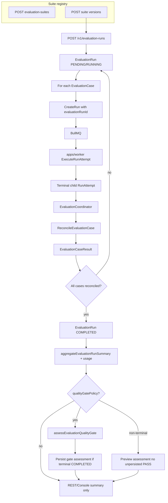

# Evaluation Run Flow

## Purpose

Execute an immutable **EvaluationSuiteVersion** by coordinating one ordinary child **Run** per **EvaluationCase**, reconcile deterministic PASS/FAIL/ERROR outcomes, aggregate **EvaluationRunSummary** (scoring + usage/cost), optionally assess a **quality gate**, and expose results on REST and Console. No separate evaluation worker or execution engine.

## Trigger / entry point

- **API:** `POST /v1/evaluation-runs` with `evaluationSuiteVersionId`, target version, optional `qualityGatePolicy`
- **Suite registry:** `POST /v1/evaluation-suites` and `POST …/versions` (immutable case snapshots)
- **Worker hook:** `EvaluationCoordinator.reconcileTerminalChildRun` after each terminal child RunAttempt

## End-to-end flow (M13.7.5)

### 1. Immutable suite version selection

Operators (API or Console) append **EvaluationSuiteVersion** rows with embedded cases. Each case defines `input`, optional `expected`, and a **JSON_EXACT_MATCH** evaluator. Versions are never mutated; new behavior requires a new version number.

Launch pins exactly one `evaluationSuiteVersionId` on the **EvaluationRun**.

### 2. EvaluationRun creation

`LaunchEvaluationRun` persists **EvaluationRun** (`PENDING` → `RUNNING`) with:

- `targetType` / `targetVersionId` (`AGENT_VERSION` or `WORKFLOW_VERSION`)
- optional `qualityGatePolicy` copied to `evaluation_runs.quality_gate_policy` (Postgres JSONB)

Child Runs inherit evaluation context; persistent memory mutation remains blocked by default.

### 3. Child Run execution

For each case, **EvaluationRunApplication** calls **CreateRun** with `evaluationRunId` and `evaluationCaseId`. Each child follows [run-execution.md](./run-execution.md) through BullMQ and `apps/worker`.

### 4. Deterministic case scoring

When a child RunAttempt reaches a terminal state, **EvaluationCoordinator** invokes **ReconcileEvaluationCase** (JSON exact match against case expectation).

- **PASS** / **FAIL** / **ERROR** is stored as an immutable **EvaluationCaseResult** per `(evaluationRunId, evaluationCaseId)`.
- Per-case score for aggregation: PASS → `1`, FAIL → `0`, ERROR → no score.

When all cases are reconciled, the coordinator transitions **EvaluationRun** to terminal **`COMPLETED`** (or **`FAILED`** / **`CANCELLED`** if the coordinator cannot progress).

### 5. Usage and cost aggregation

On each **GetEvaluationRun** (and when building launch response), the domain:

1. Loads reconciled case results and suite version case count.
2. Collects child **Run** ids and **RunAttempt** ids (logical retries add attempts; queue redelivery reuses attempt id).
3. Aggregates MODEL **RunStep** usage: tokens, priced `estimatedCostUsdMicros`, unpriced model call count.
4. Optionally computes **durationMs** from earliest/latest case `completedAt`.

Results populate **EvaluationRunSummary** (`usageMeasured`, `pricedCostUsdMicros`, `unpricedModelCalls`, etc.).

### 6. Terminal lifecycle reconciliation

**Evaluation run status** (execution lifecycle) is independent of **quality-gate verdict**:

| Run status | Coordinator meaning |
| --- | --- |
| `PENDING` / `RUNNING` | Cases still executing or not fully reconciled |
| `COMPLETED` | All cases reconciled successfully |
| `FAILED` | Coordinator/infrastructure could not finish |
| `CANCELLED` | Run cancelled |

Case-level **FAIL** (wrong output) still allows **`COMPLETED`** on the batch run; gate rules may **FAIL** on pass rate or quality score.

### 7. Quality-gate assessment and persistence

When `qualityGatePolicy` is present:

1. **Build summary** (step 5) for the current case results.
2. **If terminal** and no row exists in `evaluation_run_gate_assessments`, compute **assessEvaluationQualityGate** with `allowFinalPass: true` only when status is **`COMPLETED`**, then **insert** immutable assessment (policy snapshot + assessment JSON).
3. **If terminal row exists**, return stored assessment (idempotent reads).
4. **If non-terminal**, return preview assessment with `allowFinalPass: false`.

**Preview safety:** `suppressUnpersistedQualityGatePass` downgrades preview **overallVerdict** from **PASS** to **INDETERMINATE** so clients never treat a in-flight run as gate-passed.

**INDETERMINATE rules (examples):**

- **MISSING_EVIDENCE** — required metric absent from summary (e.g. no `qualityScore` when all cases are ERROR).
- **COST_INCONCLUSIVE_UNPRICED** — cost MAX rule but `unpricedModelCalls > 0`.
- **LIFECYCLE_INCOMPLETE** — run not terminal or final pass not allowed.

**FAILED** / **CANCELLED** runs produce gate **FAIL** (lifecycle) regardless of case metrics.

Persisted assessments are insert-once; conflicting writes raise **EvaluationGateAssessmentConflictError**.

Migration: **`0029_evaluation_quality_gate_slice`**.

### 8. REST and Console presentation

- **REST:** `GET /v1/evaluation-runs/:id` returns run status, **summary**, optional **qualityGate**, and `GET …/case-results` for per-case outcomes. List endpoint returns runs without summary/gate. See [`REST_API_V1.md`](../../contracts/REST_API_V1.md).
- **Console (Testing Studio):** suite builder, batch launch, optional gate editor on launch, run detail panel for summary + gate verdicts (M13.7.4–M13.7.5).

## Persisted objects

| Object | Notes |
| --- | --- |
| EvaluationSuite / EvaluationSuiteVersion | Version cases immutable |
| EvaluationRun | Coordinator state; optional `qualityGatePolicy` |
| Run (child) | Ordinary Run with evaluation linkage |
| RunAttempt / RunStep | Standard execution; usage source |
| EvaluationCaseResult | Immutable per case |
| EvaluationRunGateAssessment | One terminal row per gated run (optional) |

## Immutability / idempotency

- EvaluationSuiteVersion and cases are immutable.
- EvaluationCaseResult rows are immutable; duplicate reconcile with different content is rejected.
- Gate assessments are immutable once inserted.
- Child Runs use standard RunAttempt semantics; queue redelivery reuses same attempt id.

## Failure behavior

- Child Run FAILED/TIMED_OUT/CANCELLED → case outcome ERROR or FAIL per evaluator rules (not necessarily EvaluationRun infrastructure failure).
- EvaluationRun **FAILED** means coordinator could not progress (e.g. CreateRun/enqueue failure), distinct from case FAIL.
- No EvaluationWorker process — only `apps/worker` executes agent code.

## What is NOT in this flow

- Separate evaluation queue or worker type
- LLM-as-judge or semantic evaluators (only **JSON_EXACT_MATCH** today)
- Vector memory or semantic evaluators
- Memory mutation during evaluation cases (blocked by default)
- Billing/settlement — usage fields are observability aggregates

## Diagram

## Key implementation files

- `packages/domain/src/evaluation-run-application.ts`
- `packages/domain/src/evaluation-run-scoring.ts`
- `packages/domain/src/evaluation-run-usage.ts`
- `packages/domain/src/evaluation-run-usage-loader.ts`
- `packages/domain/src/evaluation-quality-gate-assessment.ts`
- `packages/domain/src/evaluation-run-quality-gate.ts`
- `packages/domain/src/evaluation-suite-application.ts`
- `packages/orchestration/src/evaluation-coordinator.ts`
- `apps/worker/src/execute-run-attempt-handler.ts`
- `apps/web/src/evaluation-http.ts`
- `packages/db/src/repositories/postgres-evaluation-suite-repository.ts`
- `packages/runtime-core/src/create-execution-request.ts` (evaluationContext)
- `packages/memory-gateway/src/memory-gateway.ts` (allowPersistentMutation guard)
