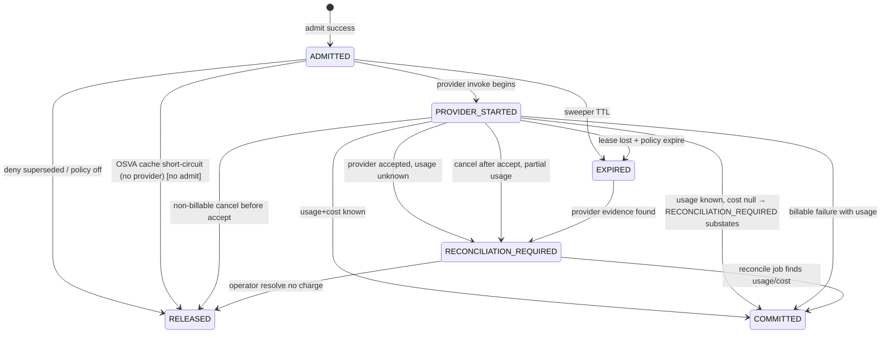

# B5 — Workspace Inference Budget Architecture (B5.0R)

**Status:** Design specification (B5.0R final corrections). **No production implementation** in this milestone.

**ADR:** `docs/adr/ADR-013-workspace-inference-budget-authority.md`

**Verification:** `docs/engineering/OSVA_VERIFICATION_STRATEGY.md` (repository copy; `ENGINEERING_VERIFICATION_PLAYBOOK.md` is not in-repo per B0–B4 consolidated acceptance).

---

## 1. Verified execution composition

### 1.1 Worker wiring

From `apps/worker/src/process.ts`:

- `modelGatewayBase = new ModelGateway({ ... })`
- Optional `providerExecutionStack = CachingModelGateway({ inner: modelGatewayBase, cache })`
- `routedProviderStack = RoutingModelGateway({ inner: providerExecutionStack, ... })`
- `createRunStepRecorder(execution, deps).wrapModelGateway(routedProviderStack)`
- **Judge:** `createEvaluationJudgeModelInvoker(modelGatewayBase)` — **no** Caching, Routing, or Recorder.

### 1.2 Call graph (sync completion)

1. Runtime calls `ObservabilityModelGateway.generateCompletion` / `generateText` (wrap API).
2. Recorder allocates `runStepId = deps.ids.createId()` (UUID), `insertRunningRunStep`.
3. Recorder calls `inner.generateTextOutcome` or `generateCompletionOutcome` with merged cache + routing options (`resolveModelGatewayGenerateOptions`).
4. `RoutingModelGateway` selects route; loop calls `invoke` → `CachingModelGateway.generate*Outcome`.
5. `CachingModelGateway`: `tryCacheRead` on **text outcome path only**; on hit, returns `OSVA_RESPONSE_CACHE_HIT` **without** calling inner.
6. On cache miss: `inner` → `ModelGateway.invokeProviderGenerate` → adapter HTTP.

### 1.3 `onProviderAttempt` timing (corrected)

In `packages/model-gateway/src/routing-model-gateway.ts`, `notifyProviderAttempt` is invoked **after** `await invoke(...)` succeeds or in the `catch` after failure. It is wired from `attachRoutingProviderAttemptTelemetry` for `MODEL_CALLS` metrics only (`packages/observability/src/routing-provider-attempt-telemetry.ts`).

**Budget admission must not use this hook.**

### 1.4 Proposed admission hook

**Component:** `BudgetEnforcingModelGateway` in `@osva/model-gateway` (name TBD).

**Methods wrapped:** All paths that reach provider I/O:

- `generateTextOutcome` / `generateCompletionOutcome` → admit → `inner.*`
- `generateCompletionStream` → admit → return `inner.generateCompletionStream` (admission failure throws before iterator starts)

**Placed as:** `CachingModelGateway`’s **inner** (child of Caching, parent of `ModelGateway`).

**Options extension** (`ModelGatewayGenerateTextOptions`):

```typescript
readonly budget?: InferenceBudgetAdmissionContextV1;
```

Populated via **`InferenceBudgetProviderAttemptContextV1`** (pre-invocation, not `onProviderAttempt`):

| Source | Fields |
| --- | --- |
| **Invocation allocator** (DB, before provider) | `inferenceInvocationId`, `invocationAnchor`, `periodKey`, `budgetPolicyVersionId`, `pricingSnapshotId` |
| **Recorder** | `runStepId` (correlation only), `runAttemptId`, `bindingName`, `modelInvocationOrdinal` |
| **RoutingModelGateway** | `providerAttemptIndex`, `selectedModelProfileVersionId` **before** `invoke()` |
| **Judge worker** | `evaluationJudgeTaskId`, `sequence` |
| **Batch processor** | `batchInferenceItemId`, submit generation |

**Admission service port** (`InferenceBudgetAdmissionPort` in contracts): `allocateInvocation`, `admitOrGetExisting`, `markProviderStarted`, `reconcile`, `release`, `markReconciliationRequired` — implemented in `@osva/db` with domain state machine validation.

**Judge and batch (mandatory when policy enabled):** Worker must wrap judge `ModelGateway` and batch submit path with the same `BudgetEnforcingModelGateway` factory used for agent runs. Policy enabled without judge/batch wiring is a **configuration error** (fail closed at worker startup in B5.3+).

---

## 2. Durable invocation identity and reservation keys

### 2.1 Why not `RunStepId`

`run-step-recorder.ts` allocates `runStepId` via `randomUUID()` per model operation. On worker recovery or execution replay, the recorder may allocate a **new** `RunStepId` for the **same** logical model operation. Budget authority **must not** anchor reservations on `RunStepId`.

`RunStepId` remains observability correlation (`inference_invocations.run_step_id` optional, updatable).

### 2.2 Durable primitive: `inference_invocations`

New PostgreSQL entity (migration `0044+`), allocated in the **same transaction** as first successful `admit` for that anchor. Justified by the same durability pattern as `run_operation_journal` (unique logical key per execution scope, workspace FK, attempt correlation) — see `packages/db/src/schema/run-operation-journal.ts`.

**Allocation order (agent path):**

1. Build deterministic `invocation_anchor` from execution context (below).
2. `allocateInvocation` → `InferenceInvocationId` (insert or return existing on conflict).
3. Build `InferenceBudgetProviderAttemptContextV1`.
4. `admitOrGetExisting` → reservation row.
5. Optionally start RunStep (may fail without releasing reservation — §3.4).

### 2.3 Invocation anchor by path

| Path | `invocation_anchor` inputs | `invocation_kind` |
| --- | --- | --- |
| Normal sync completion | `runAttemptId`, `executionGeneration`, `bindingName`, `modelInvocationOrdinal` | `SYNC` |
| Routing fallback | **Same** `InferenceInvocationId`; new `providerAttemptIndex` + `modelProfileVersionId` per reservation | `SYNC` |
| Streaming | Same anchor as sync for logical call; admit at stream open | `STREAM` |
| Execution replay | Same anchor → same `InferenceInvocationId` | unchanged |
| Logical retry | New `runAttemptId` → new anchor | new row |
| New billable call | Increment `modelInvocationOrdinal` (runtime-supplied or worker monotonic) | new row |
| Judge | `evaluationJudgeTaskId`, `sequence` | `JUDGE` |
| Batch item | `batchInferenceItemId`, workspace, immutable job pricing snapshot ref | `BATCH` |

`modelInvocationOrdinal` SHOULD be supplied by the trusted runtime when the protocol exposes a stable model-call sequence; otherwise the worker issues monotonic ordinals keyed by `(runAttemptId, bindingName)` in PostgreSQL.

### 2.4 Reservation key (per provider HTTP)

```text
reservation_key = H(
  RESERVATION_KEY_VERSION,
  inferenceInvocationId,
  providerAttemptIndex,
  selectedModelProfileVersionId,
)
```

Unique: `(workspace_id, reservation_key)`.

### 2.5 Replay vs new billable invocation

| Event | `InferenceInvocationId` | Period held capacity |
| --- | --- | --- |
| Worker replay, same anchor | Unchanged | `admitOrGetExisting` → **no second hold** |
| Admit DB retry, same key | Unchanged | Idempotent |
| New ordinal / new RunAttempt | New invocation row | New hold |
| Routing fallback index *k* | Same invocation | **Additional** hold for attempt *k* |

### 2.6 Exactly-once provider execution (explicit non-claim)

Budget **does not** claim exactly-once provider HTTP unless:

1. **Execution fencing:** `executionGeneration` on RunAttempt matches invocation row; lease lost → reconciliation, not silent release (§3.4).
2. **Adapter contract:** With budget enabled, connection adapters use **zero** SDK hidden retries (`OPENAI_CONNECTION_RESOLVED_MAX_RETRIES` pattern). Each extra HTTP without a matching reservation is an operational defect.

Separate **reservation idempotency** (capacity) from **provider idempotency** (HTTP).

---

## 2A. Routing provider-attempt lifecycle (pre-invocation)

`RoutingModelGateway` MUST NOT use `onProviderAttempt` for admission. Instead, **before** `await invoke(...)` for iteration `index`:

1. Resolve `selectedModelProfileVersionId = candidateId`.
2. Build `InferenceBudgetProviderAttemptContextV1` with `providerAttemptIndex = index`, pricing snapshot from `ModelProfileVersion`, workspace id from routing context.
3. Call inner stack; `BudgetEnforcingModelGateway` performs `allocateInvocation` (if not yet done for this anchor) + `admitOrGetExisting`.
4. On `MODEL_INFERENCE_BUDGET_EXCEEDED` (`retryable: false`, non-fallback): **abort entire routed operation** — no further candidates, no provider HTTP on later indices.

Post-invocation `onProviderAttempt` remains metrics-only (`routing-model-gateway.ts` after `invoke` returns).

---

## 3. Reservation state machine

States (`InferenceBudgetReservationStatus`):

| State | Meaning |
| --- | --- |
| `ADMITTED` | Capacity reserved; provider not yet called |
| `PROVIDER_STARTED` | Provider request issued (HTTP/stream open acknowledged) |
| `COMMITTED` | Actual liability recorded on period (`committedUsdMicros` known and ≥ 0) |
| `RELEASED` | Reserved capacity returned (no billable provider outcome) |
| `RECONCILIATION_REQUIRED` | Billable uncertainty; liability **not** auto-cleared |
| `EXPIRED` | Admin/sweeper closed stale ADMITTED/PROVIDER_STARTED with policy-defined release |

### 3.1 Transitions



### 3.2 Event policies

| Event | Transition | Rules |
| --- | --- | --- |
| **Admission** | → `ADMITTED` | `reservedUsdMicros = admitCeiling` from pricing + preflight; fail if period exhausted |
| **Provider request started** | `ADMITTED` → `PROVIDER_STARTED` | Set when adapter call/stream starts; optional timestamp |
| **Successful completion** | → `COMMITTED` | `committedUsdMicros = estimateModelCostUsdMicros(...)`; refund `reserved - committed` to period pool |
| **Billable provider failure** | → `COMMITTED` or `RECONCILIATION_REQUIRED` | If usage tokens present or provider charged failure → commit or require reconcile; never RELEASE if usage > 0 |
| **Cancellation, partial usage** | → `RECONCILIATION_REQUIRED` | Stream cancel with tokens; do not RELEASE |
| **Unknown usage/cost** | → `RECONCILIATION_REQUIRED` | **Never** `COMMITTED` with null → 0 |
| **Crash after provider accept** | Stay / → `RECONCILIATION_REQUIRED` | Sweeper does not RELEASE uncertain rows |
| **Expired worker lease** | `PROVIDER_STARTED` may → `EXPIRED` only if policy `onLeaseLoss: RECONCILE` | Default: `RECONCILIATION_REQUIRED` when provider id exists |
| **Reconciliation required** | Manual/job | Match provider request id, routing decision, batch item, RunStep if present |
| **RunStep finalize failed** | No auto-RELEASE | Reservation stays `PROVIDER_STARTED` or → `RECONCILIATION_REQUIRED`; budget tick retries reconcile |
| **Stale uncertain acceptance** | No auto-refund | `RECONCILIATION_REQUIRED` / `PROVIDER_STARTED` with provider evidence → capacity stays until operator or tick resolves |

### 3.3 Reconciliation durability (not RunStep-only)

**Primary owners** of reservation transitions:

1. `BudgetEnforcingModelGateway` — synchronous path after provider returns or stream terminal.
2. **`InferenceBudgetReconciliationTick`** — scans `PROVIDER_STARTED`, `RECONCILIATION_REQUIRED`, stale `ADMITTED`; uses provider ids, batch rows, optional RunStep rows.
3. **RunStep finalize** — **correlation input only**; `finalizeSafely` failure must not release capacity.

Unknown billability → `RECONCILIATION_REQUIRED`; liability moves from **held** to **uncertain** bucket (§4.5).

Each reservation stores **`period_key`** and **`budget_policy_version_id`** (and pricing snapshot ref) at admit for charges reconciled after UTC month rollover.

### 3.4 Streaming, cancellation, lease expiry

| Phase | Reservation behavior |
| --- | --- |
| Stream init (pre-byte) | Admit + `PROVIDER_STARTED` when adapter accepts stream |
| Mid-stream failure | If provider accepted: `RECONCILIATION_REQUIRED` when usage incomplete; else commit partial usage |
| Client cancel / `AbortSignal` before provider accept | `RELEASED` (non-billable) |
| Cancel after accept with partial usage | `RECONCILIATION_REQUIRED`; uncertain retains capacity |
| RunAttempt lease expired while `PROVIDER_STARTED` | **No automatic refund**; → `RECONCILIATION_REQUIRED` when provider id known; sweeper only expires **ADMITTED** never-called rows per policy |
| Unknown usage at stream end | `RECONCILIATION_REQUIRED`; never commit 0 |

### 3.5 Period ledger fields and capacity invariant

Per `workspace_inference_budget_periods` (proposed), maintain **mutually exclusive** buckets:

| Bucket | Includes reservation states | Excludes |
| --- | --- | --- |
| `committed_liability_usd_micros` | `COMMITTED` (full `committed_usd_micros`, including overage portion) | Held, uncertain |
| `held_reservations_usd_micros` | `ADMITTED`, `PROVIDER_STARTED` (`reserved_usd_micros` ceiling not yet resolved) | Committed, uncertain |
| `unresolved_uncertain_liability_usd_micros` | `RECONCILIATION_REQUIRED` (`uncertain_floor_usd_micros`) | Committed, held |
| `overage_usd_micros` | Audit sum of `max(0, committed - reserved_ceiling)` per reservation | Not subtracted from committed |

**Available capacity (admit check):**

```text
available_usd_micros =
  limit_usd_micros
  - committed_liability_usd_micros
  - held_reservations_usd_micros
  - unresolved_uncertain_liability_usd_micros
```

Admit when `available_usd_micros >= admit_ceiling_usd_micros`.

**Overage:** When `committed_usd_micros > reserved_usd_micros`, record full committed in `committed_liability`, increment period `overage_usd_micros` by the delta — **never truncate** committed to the reservation ceiling.

---

## 4. Budget semantics (corrected)

### 4.1 Atomic reservation admission (class A)

Use the **mutually exclusive** invariant in §3.5. Admit iff `available_usd_micros >= admit_ceiling_usd_micros` under `STRICT_PERIOD_CAP`.

**Concurrent two-worker:** second transaction blocks on `FOR UPDATE` until first commits; one admit succeeds, one fails with `MODEL_INFERENCE_BUDGET_EXCEEDED`.

### 4.2 Estimated cost accounting (class B)

- Routing `maxEstimatedCostUsdMicros` — unchanged; **not** workspace period enforcement.
- Admit ceiling may **reuse** `estimateRoutingPreflightCostUsdMicros` / per-candidate pricing with `maxOutputTokens`.

### 4.3 Actual provider charges — OSVA view (class C)

Reservation ledger drives `committedUsdMicros`; RunStep and batch rows are correlated. Provider invoice (class E) may differ; overage fields record `committed > reserved_ceiling` without truncation.

### 4.4 Unknown liabilities (class D)

- `usageIncomplete` or null `estimateModelCostUsdMicros` → `RECONCILIATION_REQUIRED`, period `uncertain_usd_micros += reservedCeiling` (or configured floor).
- **Prohibited:** `COMMITTED` with `committedUsdMicros = 0` when state is unknown.

### 4.5 UTC calendar period boundaries

`periodKey = `${year}-${month}` UTC (zero-padded month).

| Field | Rule |
| --- | --- |
| `periodStart` | `Date.UTC(year, monthIndex, 1, 0, 0, 0, 0)` |
| `periodEndExclusive` | `Date.UTC(year, monthIndex + 1, 1, 0, 0, 0, 0)` |
| Admit at `2026-01-31T23:59:59Z` | Belongs to `2026-01` |
| Admit at `2026-02-01T00:00:00Z` | Belongs to `2026-02` |

Rollover: new period row lazily created on first admit in month.

---

## 5. Invocation paths — admission entry points

| # | Path | Billable provider? | Admission |
| --- | --- | --- | --- |
| 1 | Normal `generateTextOutcome` / `generateCompletionOutcome` | Yes on cache miss | Budget → ModelGateway |
| 2 | OSVA exact-response cache hit | No | None (Caching returns before Budget) |
| 3 | Provider prompt-cache hit | Yes | Budget before adapter |
| 4 | Routing fallback attempt *k* | Yes if not OSVA hit | Budget with `providerAttemptIndex = k` |
| 5 | Streaming | Yes | Budget at `generateCompletionStream` open |
| 6 | Evaluation judge | Yes | Budget on `modelGatewayBase` path before outcome |
| 7 | Native batch | Yes | **Admit before provider batch submission** (`SUBMITTING` → provider API); reconcile on item outcome; job-level guard optional |
| 8 | Remote runtime model capability | Same as agent | `createScopedModelGateway(execution)` full stack |

**Batch:** `process-batch-inference-jobs` must call budget admit **before** provider accepts the item payload, not only at post-hoc reconcile. Denied items transition to failed without provider submit.

**Judge:** Mandatory `BudgetEnforcingModelGateway` wrap on `createEvaluationJudgeModelInvoker` input when activation enabled — identical deny semantics, no routing fallback.

**Bypass prevention:** When `workspace_inference_budget_activation.enabled`, worker **must** compose `BudgetEnforcingModelGateway` under Caching for agent path and wrap judge `ModelGateway`. Integration test asserts HTTP mock receives zero calls when admit denies.

---

## 6. Build versus reuse (B5.0R)

| Reuse | Notes |
| --- | --- |
| `estimateModelCostUsdMicros`, routing preflight estimators | Admit ceiling + reconcile |
| `lockWorkspaceOwnerScope` / workspace `FOR UPDATE` | Period serialization pattern |
| `measurableModelRunStepSql` exclusions | OSVA cache not in aggregates; budget should not count OSVA hits |
| RunStep finalize hook | Reconcile trigger (after finalize, async or same transaction policy TBD in B5.2) |
| Batch `submissionFingerprint` uniqueness | Parallel pattern for batch reservation keys |

| Build | Notes |
| --- | --- |
| `BudgetEnforcingModelGateway` | Provider gate |
| `InferenceBudgetAdmissionPort` + PostgreSQL repositories | New tables migration `0044+` |
| Contracts for keys, states, errors | `MODEL_INFERENCE_BUDGET_*` |
| Sweeper tick | Worker or scheduler |
| Control plane activation API | Mirror routing/cache activation |

| Reject | |
| --- | --- |
| Valkey spend counters | |
| `onProviderAttempt` admission | |
| New message broker / DLM | |

---

## 7. Implementation slices (B5.1+)

| Slice | Deliverable | Packages |
| --- | --- | --- |
| **B5.1** | Contracts: keys, states, errors, admission context, port interfaces | `contracts`, `domain` unit tests |
| **B5.2** | Migration `0044_inference_budget_slice`, repositories, period rollover, `FOR UPDATE` admit | `db` integration |
| **B5.3** | `BudgetEnforcingModelGateway`; `inference_invocations`; pre-invoke context; routing non-fallback on budget deny | `model-gateway`, `db`, `worker` |
| **B5.4** | Reconciliation tick (not RunStep-only); sweeper; metrics | `orchestration` or `worker` |
| **B5.5** | Judge path — mandatory budget wrap; startup fail if policy on without wrap | `apps/worker` |
| **B5.6** | Batch admit before provider submit + reconcile | `orchestration`, `worker` |
| **B5.7** | Control plane CRUD + activate (ADMIN), period GET | `web`, `domain` |
| **B5.5C.3** | Version-pinned activate/disable REST + Console; `OSVA_INFERENCE_BUDGET_ACTIVATION_ENABLED` (default **false**) gates mutations only | `web`, `console`, `db` audit |
| **B5.6A** | Runtime matrix: ACT17, declarative, REMOTE_HTTP worker E2E | `worker`, `adapters-runtime-declarative`, `adapters-runtime-http` |
| **B5.6B** | REMOTE H6 dynamic activation; container K-series harness; Compose/Helm gate docs; operator runbook | `worker`, `deploy`, `docs/operations` |

**B5.6B container note (RC):** Local Docker K-series **10/10 PASS** for Protocol V1 **generate-text** (admit, deny, dynamic activation, echo w/ budget off). **Streaming is UNSUPPORTED** on the container capability surface (K9). Invalid bearer-token E2E on container remains **NOT VERIFIED**. Hosted CI and production smoke are human gates before production enablement.

**B5.5C.3 activation gate:** `OSVA_INFERENCE_BUDGET_ACTIVATION_ENABLED` on the web process defaults **false**. When off, workers still enforce an already-active `workspace_inference_budget_activation` row; only HTTP activate/disable are rejected. Disabling workspace enforcement does not reset monthly buckets or erase ledger liability.

One meaningful product commit per slice per `AGENTS.md`.

---

## 8. Outstanding risks and deferred scope

| Risk | Mitigation |
| --- | --- |
| Fallback attempts under-counted in RunStep SQL rollup | Budget uses per-attempt keys, not RunStep sum alone |
| Admit ceiling < actual usage | `overage_usd_micros` + RECONCILIATION_REQUIRED; optional pessimistic multiplier in policy |
| Workspace hot-spot | `FOR UPDATE` serializes admits; document limit |
| Judge without recorder | Dedicated scope in B5.5 |
| Batch submit before provider accepts | Admit at submit with RELEASE if provider rejects item |
| Invoice vs OSVA estimate | Class E manual; no automatic cap |

**Deferred:** org-level rollups, provider invoice ingest, Valkey cross-worker breaker-style budget, semantic cache interactions, absolute dollar SLA, GPU non-token pricing, per-organization policy inheritance.

---

## 9. B5.0R correction log

| Issue | Final resolution |
| --- | --- |
| `onProviderAttempt` admission | Pre-invoke `InferenceBudgetProviderAttemptContextV1` + `BudgetEnforcingModelGateway` |
| Unstable `RunStepId` | `inference_invocations.invocation_anchor` + `InferenceInvocationId` before provider |
| RunStep-only reconcile | Reservation ledger + reconciliation tick |
| Capacity double-count | Mutually exclusive committed / held / uncertain buckets (§3.5) |
| Overage truncation | Full `committed_usd_micros` + `overage_usd_micros` audit |
| Budget deny + routing fallback | `MODEL_INFERENCE_BUDGET_EXCEEDED` non-retryable, non-fallback |
| Batch reconcile-only admit | Admit before provider submission |
| Judge bypass | Mandatory budget wrap when policy enabled |